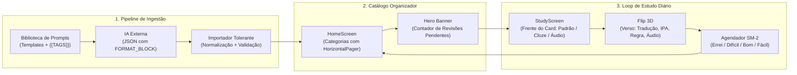

# Design System & Codebase Specification: FlashLang
**Package:** `com.cristiano.flashlang`  
**Target Platform:** Android (API 26+)  
**Architecture:** Jetpack Compose (Material 3), MVVM (`ViewModel` + `StateFlow`), Room (KSP), Navigation Compose, Android TextToSpeech

---

## 1. Codebase Purpose & Product Vision

### 1.1 Real Content & Tagline (from `README.md`)
> **FlashLang** é um aplicativo Android local de **flashcards para aprendizado de inglês e espanhol**, acompanhado de uma biblioteca de **prompts para gerar baralhos com inteligência artificial**.

- **Workflow do Usuário:** O estudante escolhe uma atividade/prompt pedagógico (ex.: vocabulário de textos lidos, verbos regulares terminados em `-ed`, vogais curtas e longas, falsos cognatos), copia o prompt parametrizado para uma IA externa (ChatGPT, Claude, Gemini), recebe um JSON estruturado, importa para o FlashLang e estuda com repetição espaçada (SM-2), cards de lacuna (*cloze*), pronúncia por áudio nativo (TextToSpeech), notação fonética (IPA) e regras pedagógicas no verso.
- **Filosofia Arquitetural:** 100% local, *offline-first*, sem cadastro, sem servidor e sem telemetria. Baralhos, histórico de revisões e prompts ficam exclusivamente no banco de dados local do dispositivo.
- **Idiomas Suportados:**
  - Aprendizado: Inglês (`en-US`) e Espanhol (`es-ES`).
  - Interface do usuário e mensagens de erro: Português do Brasil (`pt-BR`).
  - Código-fonte (classes, funções, variáveis, testes): Inglês (`en-US`).

### 1.2 O que o README Lidera (Feature Dominante)
A funcionalidade mestra que dita o peso e a hierarquia do aplicativo é a **sinergia entre Prompts de IA e o Ciclo de Estudo**:
1. **Biblioteca de Prompts Prontos e Próprios:** Prompts categorizados (*Vocabulário*, *Pronúncia*, *Conversa*), com marcadores injetáveis (`{{IDIOMA}}`, `{{TEXTO}}`, `{{LISTA}}`, `{{FOCO}}`) e anexo obrigatório do bloco de formato (`FORMAT_BLOCK`) que assegura compatibilidade na importação.
2. **Importador Tolerante:** Ingestão de JSON com princípio da robustez (*strict parse* primeiro; limpeza agressiva como *fallback* contra cercas markdown, aspas curvas, espaços invisíveis e normalização de variantes).
3. **Loop de Estudo Ativo com SRS:** Cards 3D com virada fluida, áudio automático no modo Pronúncia (botão central de 96dp), suporte nativo a lacunas (*cloze*) e 4 graus de avaliação com cálculo de repetição espaçada.

---

## 2. Forma Nativa do Produto (Native Shape)

O FlashLang não segue o modelo de um CRUD genérico. Sua arquitetura é moldada pela união de três padrões funcionais:

1. **Pipeline de Ingestão:** Converte texto livre ou listas de palavras em baralhos estruturados sem exigir digitação manual card por card.
2. **Catálogo de Baralhos:** Organiza o conhecimento em abas dinâmicas acionadas por toque e deslizamento horizontal (`HorizontalPager`), seções colapsáveis e badges visuais de status.
3. **Loop de Estudo Diário:** Apresenta exclusivamente os cartões que venceram no dia, oferecendo treino auditivo, fonético e contextual antes do reforço de memória.

---

## 3. Arquivos Críticos do Projeto

| Camada | Arquivo | Responsabilidade Crítica |
|---|---|---|
| **Banco de Dados** | `data/db/AppDatabase.kt` | Definição do banco Room, DAOs e migrações incrementais (`MIGRATION_1_2` a `MIGRATION_5_6`). **Nunca usar `fallbackToDestructiveMigration`**. |
| **Modelos de Dados** | `data/model/FlashCard.kt` | Entidade do cartão com formato (`basic` ou `cloze`), campos de pronúncia (`ipa`, `note`) e estado SRS (`easeFactor`, `intervalDays`, `repetitions`, `dueAt`). |
| **Modelos de Dados** | `data/model/Deck.kt` | Entidade do baralho com idioma (`en` ou `es`) e chave estrangeira em cascata para os cartões. |
| **Modelos de Dados** | `data/model/UserPrompt.kt` | Prompts criados ou duplicados pelo usuário com flag `generatesDeck`. |
| **Algoritmo SRS** | `data/scheduler/Scheduler.kt` | Função pura do algoritmo SM-2: cálculo de intervalos (10 min em erro, 1 dia, 3 dias, etc.) e ajuste do fator de facilidade (mínimo 1.3). |
| **Importador JSON** | `data/importer/DeckImporter.kt` | Ingestão resiliente de JSON. Tratamento de aspas curvas, entidades HTML, vírgulas finais e normalização de chaves. |
| **Normalização Cloze** | `data/importer/ClozeText.kt` | Criação e normalização de lacunas `___` em frases de exemplo. |
| **Templates de IA** | `data/prompts/PromptTemplates.kt` | Textos pedagógicos imutáveis dos prompts de vocabulário e pronúncia com o `FORMAT_BLOCK`. |
| **Backup & SAF** | `data/backup/BackupService.kt` | Exportação e restauração transacional em JSON, usando exclusivamente `cacheDir/exports/` via `FileProvider`. |
| **Tela Principal** | `ui/home/HomeScreen.kt` | Catálogo de baralhos, `HorizontalPager` bidirecional com chips de categoria, `HeroBanner` e menus contextuais `.popup`. |
| **Tela de Estudo** | `ui/study/StudyScreen.kt` | Sessão de estudo, animação de flip 3D, modo Pronúncia com botão 96dp, bottom sheets de opções, modo e voz TTS. |
| **Preferências** | `ui/study/StudyPreferences.kt` | Preferências de modo de estudo (`STANDARD`, `INVERTED`, `PRONUNCIATION`) e taxa lenta (`0.6f`). |
| **Prompts UI** | `ui/prompts/PromptsScreen.kt` | Lista de prompts com blocos tracejados (`.drop`) e categorização. |
| **Import UI** | `ui/importdeck/ImportScreen.kt` | Interface de importação com caixa monoespaçada, validação em tempo real e tratamento de teclado (`imePadding`). |

---

## 4. Visual Theme & Atmosphere

### 4.1 Atmosfera Estética
- **Tom & Filosofia:** Focado, imersivo, utilitário e tipograficamente refinado. Prioriza o modo escuro (*Dark Mode*) profundo para sessões prolongadas de leitura e memorização noturna, eliminando distrações visuais.
- **Densidade:** Equilibrada. Áreas de toque confortáveis (mínimo de 48dp), respiros generosos entre blocos de estudo e cartões elevados com bordas sutis.
- **Hierarquia:** O termo central e os botões de áudio possuem escala dominante no momento do estudo; metadados (contadores, categorias e identificadores técnicos de voz) utilizam pesos médios e tons atenuados.

---

## 5. Color Palette & Semantic Tokens

### 5.1 Cores Base e Superfícies (Dark Theme Oficial)
* **Background Profundo (`--bg` / `BackgroundDark`):** `#12161F` (Azul-carvão escuro profundo utilizado como tela de fundo).
* **Superfície Principal (`--surface` / `SurfaceDark`):** `#1A1F2B` (Superfície azul-noite usada em containers, cards de baralho e bottom sheets).
* **Superfície Elevada (`--surface-2` / `SurfaceContainerHighDark`):** `#283145` (Superfície intermediária usada em popups flutuantes `.popup`, diálogos modais `.dialog` e pílulas secundárias).
* **Superfície Máxima (`SurfaceContainerHighestDark`):** `#333E57` (Elementos de alto contraste ou relevo).

### 5.2 Cores de Ação e Destaque
* **Verde Destaque Primário (`--primary` / `SuccessDark`):** `#4ADE80` / `#10B981` (Verde esmeralda vibrante para botões primários `.btn-primary`, anéis de radio buttons ativos `.radio.on` e switches ligados).
* **Tinta do Primário (`--primary-ink` / `OnPrimaryDark`):** `#0B2914` / `#111827` (Grafite escuro profundo para textos e ícones sobre fundos primários).
* **Primário Suave / Fundo Tonal (`--primary-soft` / `PrimaryContainerDark`):** `#1A3826` / `#2B3754` (Fundo sutil para chips ativos, tags de marcadores `.tag` e botões tonais `.btn-tonal`).
* **Índigo Estrutural (`PrimaryDark` no Compose):** `#7C8CE4` (Índigo vibrante para ícones temáticos e chevrons).

### 5.3 Badges e Indicadores Semânticos
* **Badge Âmbar de Revisão (`BadgeAmberBackgroundDark` + `BadgeAmberTextDark`):**
  - Fundo: `#5A3D05`
  - Texto/Ícone: `#F5C26B`
  - *Função:* Destacar baralhos que possuem cards pendentes para revisão no dia.
* **Badge Verde Em Dia (`BadgeGreenBackgroundDark` + `BadgeGreenTextDark`):**
  - Fundo: `#12503A`
  - Texto/Ícone: `#7EE0B0`
  - *Função:* Indicar baralhos sem pendências ("Em dia").
* **Alerta / Ação Destrutiva (`--red` / `ErrorDark`):**
  - Texto e Borda: `#F87171` / `#EF4444`
  - Fundo do Botão de Exclusão (`--red-bg`): `#2D1519`
  - *Função:* Itens de exclusão em menus contextuais e botão "Excluir" em diálogos de confirmação (`.btn-danger`).

### 5.4 Contornos e Linhas
* **Divisores e Bordas (`--line` / `OutlineDark`):** `#8D96A8` com opacidade reduzida (0.35f a 0.5f).
* **Texto Secundário / Muted (`--muted` / `OnSurfaceVariantDark`):** `#C4CADA` (utilizado para subtítulos técnicos e legendas informativas).
* **Texto Atenuado (`--faint`):** `#71788E` (usado em contadores secundários como `+ 5 vozes` e placeholders).

---

## 6. Typography & Scale

A tipografia é baseada na fonte padrão do Material 3 com hierarquia semântica rigorosa:

* **Contador de Hero Banner:** `32sp Bold` (Destaca a contagem de revisões pendentes no topo da HomeScreen).
* **Títulos de Diálogos e Modais:** `17sp a 19sp SemiBold` (Usado em `ModalBottomSheet` e `Dialog`).
* **Termo do Flashcard (Frente/Verso):** `24sp a 28sp SemiBold` (Legibilidade máxima para memorização do vocabulário).
* **Títulos de Seção e Cards:** `15sp a 16sp SemiBold` (Nomes de baralhos e títulos de seções colapsáveis).
* **Corpo e Itens de Menu (`.mi`):** `14sp a 15sp Regular / Medium` (Navegação contextual e descrições).
* **Texto de Apoio / Metadados:** `12sp a 13sp Regular` (Identificadores técnicos de voz, IPA `/wɔːkt/`, regras gramaticais e frases de exemplo traduzidas).
* **Blocos de Código e JSON (`.mono`):** `12sp a 13sp Monospace` (Pré-visualização do prompt e área de importação).

---

## 7. Component Patterns & Geometry

### 7.1 Escala de Formas (Border Radius)
* **Pílulas Completas (`999dp`):**
  - Chips de filtro de categoria (`CategoryFilterChip`).
  - Campo de busca arredondado (`.search`).
  - Pílulas de controle de estudo (`.pill` para "Ouvir de novo", "Ouvir devagar", "Mostrar palavra").
* **Containers Flutuantes e Modais (`24dp`):**
  - Bottom Sheets (`.sheet`): cantos arredondados no topo de `24dp`.
  - Diálogos centrais de confirmação (`.dialog`): cantos arredondados de `24dp`.
* **Cards, Botões e Popups (`14dp`):**
  - Cartões de baralho na lista (`HomeDeckRow`).
  - Menus popup flutuantes (`.popup`): largura de `200dp` a `220dp` com cantos de `14dp`.
  - Botões de ação principais (`.btn-primary`, `.btn-tonal`, `.btn-danger`).
* **Barra de Arraste (`.grab`):**
  - Pílula horizontal centralizada de `36dp x 4dp` com raio de `9dp`.
* **Radio Buttons Customizados (`CustomStudyRadioButton`):**
  - Círculo de `20dp` com borda de `2dp` e ponto central preenchido de `10dp` quando ativo.

### 7.2 Regras de Interação e Acessibilidade
* **Área de Toque Mínima:** Todos os botões, ícones clicáveis e itens de lista possuem área mínima de **48dp** para garantir conforto táctil.
* **Ícones:** **Exclusivamente Material Icons Outlined**. Todo item de menu contextual deve possuir `leadingIcon`.
* **Linhas Quebráveis:** Linhas de chips ou botões dinâmicos devem utilizar `FlowRow` para evitar truncamento em dispositivos com escala de fonte ampliada.
* **Teclado Virtual:** Telas com formulários ou entradas de texto extensas (`ImportScreen`, `CardEditorScreen`, `UserPromptEditorScreen`) aplicam obrigatoriamente `Modifier.imePadding()` para prevenir sobreposição pelo teclado.

